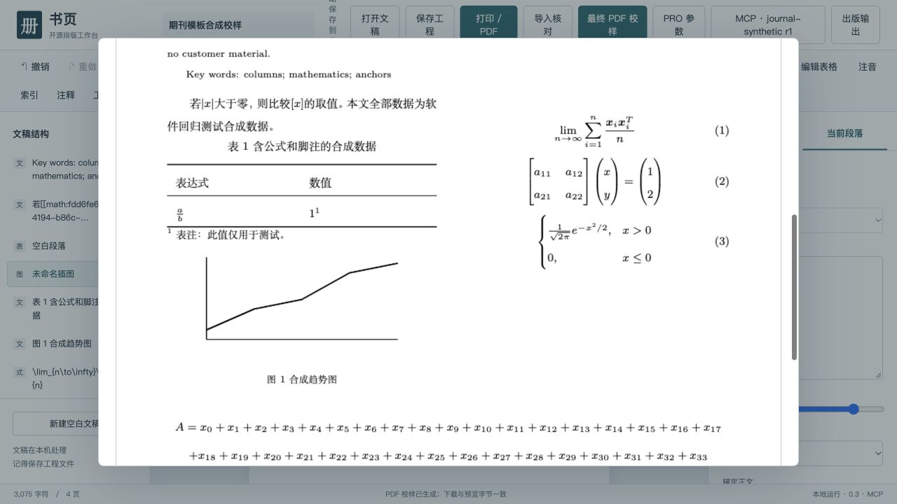

# 中文学术期刊 v4：实稿试产记录

2026-10-16。本轮补齐了可配置的双语首面、复杂 OMML 转换和显式图表锚点，并在用户本机通过 MCP stdio 完整运行一篇真实数学类稿件。**这是一份可审阅的试产候选，尚未达到收费发印验收。** 真实稿件、姓名、图件、PDF、源文件哈希和本机路径不进入公开仓库。

## 本轮实现

- 工程 v4 保存期刊元数据与段落角色：中英文题名、作者、单位、摘要、关键词，分类信息、引用、作者注与参考文献。PDF 首面通栏、正文双栏；卷期、刊名和续页短标题可设。作者上下标和源稿脚注符号保留。角色是对原段落的标记，不是自动生成缺失的出版字段。
- OMML 增加函数、极限、矩阵、多行、上下限、粗体/正体/粗斜体、重音、组合符与分式类型。每个公式保留源 XML 和摘要，未知结构继续阻断。宽公式经过实测宽度后通栏或分行，公式编号与正文分开存储。它仍不是完整 OMML/MathType 转换器，不能用数量相等替代语义校对。
- 图表可指定正文锚点、前后顺序、允许相隔页数和中英文题注段落。题注随图表输出；短表整表保持，长表重复表头和续表题注；表内公式、上下标、脚注保留。段内浮动图、环绕和全局浮动优化仍未覆盖。
- Word 自动编号按 numId、层级、起始覆盖与重启恢复。完整且非空的 Word 域缓存保留并提示核对；不会访问外部链接或假装重新计算交叉引用。未支持编号格式、修订与复杂注释继续阻断。
- `get_proof_page` 新增语义对象起止点：稳定块 ID/公式 ID → 最终 PDF 页与 pt 坐标。报告检查题注同页和锚点页距，仍保留候选、修订、文档摘要和 PDF 摘要绑定。坐标是语义标记，不是墨迹框或碰撞检测。

## 真实稿件结果

| 检查 | 本机结果 | 证据能说明什么 |
| --- | --- | --- |
| 源公式 | 295 / 295 | 保留的 OMML 子树与原 DOCX 对照，来源摘要可核验；不等于逐式排版语义验收 |
| 图像与表格 | 7 图、7 表 | 图像字节保留；表内公式、上下标和数据进入排版 |
| 文献编号 | 34 / 34 | 原自动编号恢复为可见编号，并在 PDF 中检出 |
| 源对象定位 | 491 / 491 | 每个块与行内公式具有可查询起止位置 |
| 锚点关系 | 14 / 14 | 满足指定先后顺序与页距；不推导自动识别首次引文正确 |
| 校样 | 16 页，170 × 240 mm | 通过 MCP 完整导入、设版、候选、提交、导出和逐页查询 |
| 最终编译/文字出页 | 0 / 0 | 字体全部嵌入；完整校样生成 300 dpi 单页图并逐页检查 |
| 有效图像分辨率 | 5 张低于 300 dpi | 源图问题仍阻断发印，未插值伪造清晰度 |

实稿运行发现并修复：作者符号脚注丢失、参考文献自动编号缺失、公式属性丢失、行内宽公式出栏、公式后的闭括号孤立、连续标题占用不足的页尾空间、数学单元格首行基线偏移、短表末行独占下一页、续表重复 PDF 目标、图注与图体脱离。

`discardedLayoutTrials` 单独记录 multicol 明确放弃且随后重新分页的试排溢出。只有日志出现对应的“放弃平衡、正常分页”证据，才与最终溢出区分；未匹配、横向溢出和缺字仍按错误处理。受信任的 Python 调用可用 `render_pdf(..., evidence_dir=新目录)` 保留 TeX 与原始日志，MCP 返回诊断摘要。该实稿有 1 条这样的已放弃试排；没有屏蔽全局 TeX 警告。

当前仍不满足交付的项目：部分宽公式频繁切换通栏，页面留白与标题、正文衔接还需精排；目标期刊编辑未签认模板和科学公式；稿件内出版字段待编辑补全；5 张原图需高清或矢量版本；字体许可、指定印厂配置和 PDF/X 等按合同验收。整期组刊、并行吞吐、断点恢复与跨环境同版也没有由本次单篇证明。程序继续返回 `productionReady:false`。

## 复现与检查

依赖 Python、Node、XeLaTeX（ctex、amsmath、amssymb、fancyhdr、multicol、longtable、booktabs、multirow、ruby、ulem、needspace）。CI 使用 Fandol；本机实稿采用已安装的思源宋体/黑体。字体方案不同不保证分页相同。

```sh
npm ci
python -m pip install -r requirements.txt
SHUYE_TEST_PDF=1 npm test
python -m unittest discover -s tests -p 'test_*.py'
python scripts/journal-template-smoke.py output/journal-v4-001
python scripts/journal-smoke.py output/journal-v3-regression-001
python scripts/check-acceptance.py
```

输出目录必须不存在。新合成样本包含双语首面、极限求和、矩阵、分段函数、长公式、图表锚点、表注及 64 行续表，4 页、28 / 28 对象定位，无质量错误；仍为 `INCOMPLETE`，不是发印批准。原合成回归也继续执行。当前本机 Node 87 通过、1 项跳过，Python 47 通过；跳过项是未配置 Playwright 模块的可选浏览器测试，远端结果以当前提交 checks 为准。

AI 可通过 `apply_changes` / `render_candidate` 提交以下事务片段，不需要 computer use：

```json
{"expectedRevision":3,"operations":[
  {"op":"set_journal","journal":{"template":"cn-academic","name":"合成期刊","nameEn":"Synthetic Journal","volume":"1","issue":"1","year":"2026"}},
  {"op":"update_block","blockId":"figure-1","patch":{"placement":"column","anchor":{"targetId":"intro","position":"after","maxPageDistance":1},"captionIds":["caption-zh","caption-en"]}}
]}
```

片段需与目标工程中的真实 ID 配套，外层请求另带 `projectId`。先取工程修订，候选实际排版，读取 `semanticLayout` / 页面坐标，检查诊断，再按同一修订提交；结构检查不签发生产许可。浏览器提供相同字段编辑入口，其编辑分页仍独立于 PDF，界面明确提示查看最终校样。



## 依据与后续收费门

OMML 字形语义参考 [Microsoft Style](https://learn.microsoft.com/en-us/dotnet/api/documentformat.openxml.math.style?view=openxml-3.0.1)，编号重启参考 [LevelRestart](https://learn.microsoft.com/en-us/dotnet/api/documentformat.openxml.wordprocessing.levelrestart?view=openxml-3.0.1) 与 [Word 编号实现说明](https://learn.microsoft.com/en-us/openspecs/office_standards/ms-oi29500/ea3612c8-a099-46c3-99a9-93658a30cb01)。超过已验证范围的字母、重复符号编号保持阻断，不猜测兼容结果。

与 [方正飞翔官方手册调研](founder-fly-journal-gap.md) 对照，本轮落实了模板、显式锚定和对象定位的第一步；尚无飞翔实机同稿结果，不能宣称对等。下一步先收敛本模板的公式断行与留白，补齐原图，做编辑逐式/逐表验收和印厂打样，再以真实人工分钟、返修轮数、一次验收率核算报价；当前没有足够数据承诺毛利。
