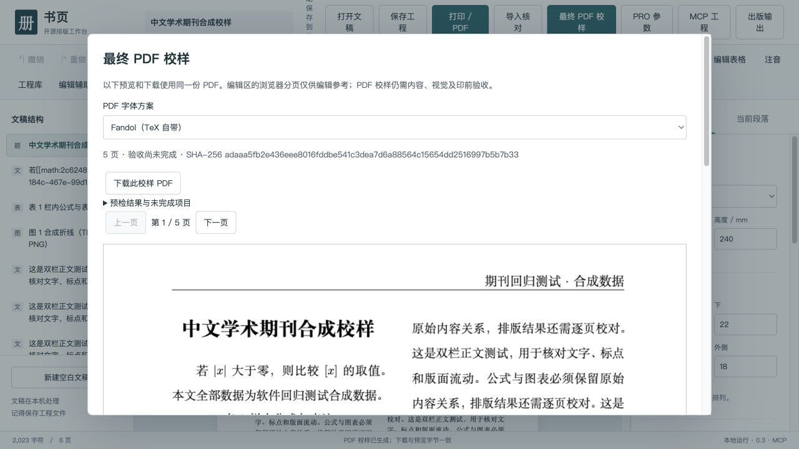

# 期刊生产验收：本次 PR 的证据与边界

当前实现与实稿结果以 [v4 期刊试产记录](journal-pilot-v4.md) 为准；下文保留第一轮 v3 回归证据。

本次修复面向中文学术期刊试产。**结构合法、PDF 可生成、测试通过，均不代表正式发印批准。** 官方竞品调研和产品优先级见 [方正飞翔对照](founder-fly-journal-gap.md)。

## 可重复执行

安装 Python 3.10+、Node 22.13+ 或 24+、XeLaTeX（含 ctex、Fandol、ruby、multirow 等宏包）：

```sh
npm ci
python -m pip install -r requirements.txt
npm test
python -m unittest discover -s tests -p 'test_*.py'
# 对候选、页坐标、并发修订做真实 XeLaTeX 集成测试（POSIX）：
SHUYE_TEST_PDF=1 npm test
# 输出目录必须不存在，不覆盖旧证据：
python scripts/journal-smoke.py output/journal-smoke-001
python scripts/check-acceptance.py
```

Windows PowerShell 使用 `$env:SHUYE_TEST_PDF='1'` 后运行 `npm test`。`SHUYE_PYTHON` 可指定 Python 可执行文件，XeLaTeX 必须在其继承的 PATH 上。CI 新增 Linux/Fandol 的实际 PDF 任务并上传原创校样；原 Windows/Linux 基础任务保留。CI 的远程结果以对应 PR 的 checks 为准。

`journal-smoke.py` 从原创 XML 与测试图生成 DOCX，执行导入、排版、字体/图像检查和 PDF 文字几何检查。输出 `synthetic.docx`、`journal.shuye.json`、`proof.pdf`、`proof-report.json`，不读取客户资料。此脚本不代替全册/整期验收。

## 本机已验证（2026-10-15–16）

- Node 基础及真实候选链路：83 通过，1 项原有可选浏览器测试跳过；Python：35 通过，包含两项实际 XeLaTeX 编译。
- 原创 170 × 240 mm、双栏、栏内公式表、TIFF 插图、表注和 64 行通栏续表：生成 5 页；字体全部嵌入，文字出页 0，未发现编译缺字/超宽提示。5 页均生成 300 dpi 单页图并查看。第 2 页留白来自样本中为续表单独插入的分页，不是紧凑排版基准。
- 12 pt 左对齐标题和 36 pt 右对齐楷体标题真实编译，PDF 字号测量符合输入，后者实际使用 FandolKai；不能把字体方案覆盖范围扩写为所有操作系统已验证。
- 原失败稿件仅在用户本机只读重测：15 张 TIFF 导入 15 张；另一个样本 295 个数学对象保持 295，其中 278 个仍在正文/单元格位置。源文件哈希前后不变。复杂结构仍有阻断诊断，**数量相等不是无损证明**。真实稿件、标题和原图不随 PR 上传。
- 浏览器：实际导入 DOCX，纸面显示 3 个行内/表内 KaTeX 公式和 1 张图；刷新后来源哈希和导入诊断仍在；含公式的纸面关闭直接文本编辑，避免 KaTeX DOM 被写回正文。

本机使用 Python 3.12.14、Node 26.5.0、TeX Live 2026；不是跨环境同版证明。测试生成的 PDF 可能因时间戳或依赖版本改变而有不同字节；每次报告绑定的是该次实际交付字节，不能把哈希不同直接解释为内容不同。

浏览器生成、屏幕报告与实际下载均绑定同一份 5 页 PDF：`adaaa5fb2e436eee8016fddbe541c3dea7d6a88564c15654dd2516997b5b7b33`。此哈希仅标识本次合成样本，不是客户成品。



## 质量状态契约

| 信号 | 含义 | 不能推导 |
| --- | --- | --- |
| `validate_project.valid` / `structureValid` | schema 与引用合法 | 内容保真、版面或印前通过 |
| `contentStatus: BLOCKED` | 保留的导入记录含错误 | 自动修复已完成 |
| `visualPaginationChecked:false` | dry-run 没有执行实际排版 | “候选已看过” |
| `geometry.status: COMPLETE` | 当前预算内完成可提取文字的度量框扫描 | 全部墨迹/图片/遮挡正确 |
| `NOT_CHECKED` / `INCOMPLETE` | 缺依赖、超预算或仍有未完成检查 | PASS |
| `quality.status: BLOCKED` | 发现导入错误、文字出页、缺字/字形替代/超宽、未嵌字体或图像 DPI 问题 | 可收费发印 |
| `productionReady:false` | 本工具没有签发印厂生产批准 | 无条件发布许可 |

新校样的默认图像阈值为 300 dpi，可通过 `options.minDpi` 显式修改；这不是所有线图、网点或印厂通用的技术标准。旧独立 PDF 预检入口仍保留其可配置阈值。PDF 文字几何基于 [pdfminer.six 页面布局 API](https://pdfminersix.readthedocs.io/en/latest/tutorial/extract_pages.html)；浏览器校样基于 [PDF.js 官方接口](https://mozilla.github.io/pdf.js/examples/)，所有运行资源本地加载。

## 第一轮 v3 的模型迁移与限制（后续以 v4 记录为准）

v1/v2 旧工程可读；v3 增加 `inlineMath`、`importReports`、PDF 字体方案及表格位置。新字段触发升级为 v3，旧版程序应拒绝打开，避免静默丢字段。公式标记须与同块定义一一对应。原 DOCX 不嵌入工程；独立保留它，并以导入 SHA-256 核对来源。导入审计是历史证据，普通编辑不能自动消除旧问题；修复原稿重新导入新工程，或另建有审批记录的处置流程。

禁止半截公式标记、重复标记和失联定义；含公式的表格删行/列会在事务后复核。需要有意删除公式，可同一事务一起移除标记与定义。章节合并保留各份导入报告。浏览器行内公式不直接在纸面打字，使用右侧内容框及公式框。

OMML 仍是部分转换器，尚未覆盖所有函数、极限、重音、多行、字形和 MathType/OLE。公式计数只覆盖 document.xml 中的数学对象；注释中的复杂对象单独报告阻断。段内图片/表内图片锚定尚未完整支持。CMYK、多帧、高位深 TIFF 不做未经确认的色彩/位深转换，而是阻断并保留来源记录。

候选 PDF 已有修订号和哈希，但没有语义对象框映射、同一约束下的自动搜索、视觉差异分类或批准/签发事务；并发检查不是多进程资源调度器。所有检测都是有界扫描；超大/连续复杂整期、恢复、负载和跨平台测试仍需补齐。

表后注是当前表注策略：长表表注在整表末尾，不保证与首次引用同页；正文脚注仍依赖 TeX，重复引用使用稳定编号。精细字号、行距、禁止背题、跨页合并表、首面通栏、图注与正文引用联动、参考文献格式及印厂配置，仍是下一阶段的收费交付门。

本次没有改写旧 `acceptance.json` 的整体兼容状态，也没有宣称与方正飞翔/书版完整对等。
